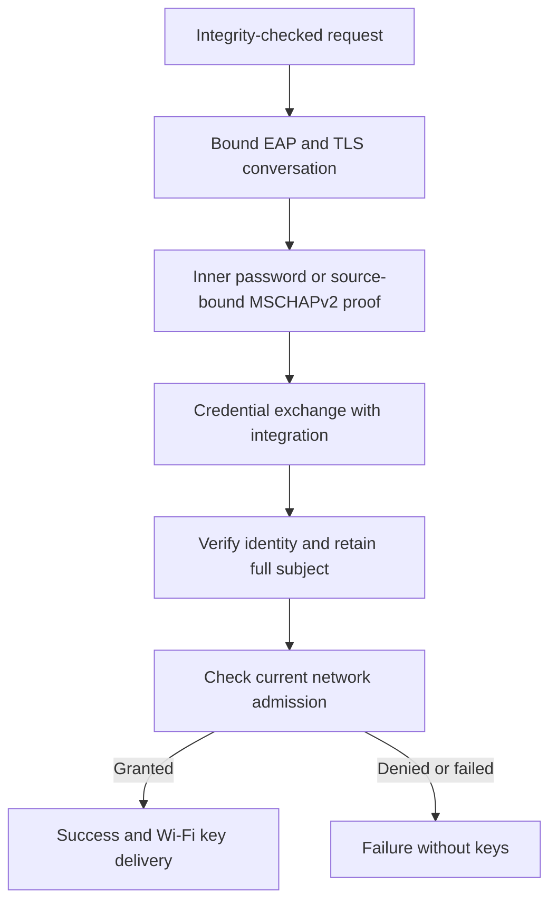

The `radius` repository contains the portable RADIUS authentication core,
the native `radiusd` daemon, the `radius` administration program, and a
host-side qualification fixture.
The native integration uses existing Peios services and kernel APIs;
packaging and real AP qualification are separate milestones.

## Responsibilities

The core implements UDP RADIUS authentication, EAP-TTLSv0/PAP and
PEAPv0/EAP-MSCHAPv2. Rustls handles TLS; ring supplies its cryptographic
primitives. RADIUS uses MD5 and HMAC-MD5 only where required by its wire
format, through existing cryptographic libraries.

The caller owns sockets, trusted-client selection, network mapping,
configuration, identity verification, and network admission. It supplies
the actual packet source and a `Binding` consisting of client identity,
trust generation, and network identity. Asserted NAS attributes do not
establish this binding.

The core has no registry, account database, OS token, or impersonation
authority. The loopback-only `radius-test-server` is a fixture with one
test identity. It is not a production backend or an installable service.

## Conversation

An outer identity such as `anonymous` introduces the EAP exchange. The
inner username and credential proof drive verification. The outer name grants
no user authority and need not match the inner name.

`Engine::receive` returns a reply, a one-shot verification event or a
drop. Credentials are owned by that event; its password buffer is
erased on drop, and debug output is redacted. PEAP also returns a typed
MSCHAPv2 response event after the source-issued challenge. The Peios adapter
uses authd Authenticate and retains its verified identity, source groups
and permitted claims on that same attempt. It then evaluates the
network's Connect descriptor using the advisory access-check API.

Only an explicit `Engine::finish` admission result can deliver success
and keys. It rechecks the deadline, source/client/network binding, and
shared secret. A changed trust definition requires a fresh exchange.
The current policy generation accompanies completion, keeping the reply
cache consistent with the decision actually made. The caller is trusted
to evaluate that current policy; a generation number is not proof of a
grant.

The core does not perform a later username lookup to reconstruct a
subject. Backend failure and insufficient identity context do not grant
network access. The protocol core receives the admission outcome and
does not depend on authd, registry or KACS types.

## Protocol and TLS scope

Every request requires a valid Message-Authenticator. Malformed and
unauthenticated datagrams are discarded without replies. Reply integrity
includes both the Message-Authenticator and Response Authenticator.
The original authenticated request determines key wrapping for its reply.

TTLSv0/PAP supports both TLS 1.2 and TLS 1.3, with
version-specific key derivation. TLS 1.2 uses the TTLS exporter label
without context; TLS 1.3 uses the EAP key-material exporter with the TTLS
type as context. Both request 128 bytes before splitting the result.

PEAPv0/EAP-MSCHAPv2 uses TLS 1.2 in this initial compatibility slice,
with the `client EAP encryption` exporter label. The core relays a
source-issued challenge and the client's response, without receiving
the password or reusable NT hash. It sends the exchange-specific server
proof only after authentication and admission succeed. Final success
and Wi-Fi key delivery wait for the MSCHAPv2 success acknowledgment and
the tunneled Result TLV acknowledgment, followed by another current
network-admission check. Cryptographic credential checking belongs to
authd's principal source. PEAP cryptobinding extensions and TLS 1.3 for
PEAP are not implemented in this slice.

Each network has an ordered allowed-method list. Negotiation can select
an allowed, untried alternative before TLS begins; a credential failure
does not cause method fallback. Named authentication profiles explicitly
choose the allowed methods and their order. EAP-TLS and method-specific
admission rules remain future work.

Full authentication is required each time. Session storage, ticket
resumption, and early data are disabled. Ordinary TLS server defaults
are therefore unsuitable without the core's explicit configuration.
No client certificate is required, but the client validates the server's
certificate chain and expected identity before disclosing credentials.

Proxy-State, direct outer password methods, accounting, additional EAP
methods, and application SSO are outside this slice.

## Resource and retransmission bounds

| Resource | Default or bound |
|---|---|
| RADIUS declared packet length | At most 4096 bytes |
| Reassembled TLS message | At most 65536 bytes |
| Buffered inner AVPs | At most 4096 bytes |
| Inner username | 1 to 253 bytes |
| Inner password before padding removal | At most 1024 bytes |
| Configured shared secret | 16 to 1024 bytes |
| Idle conversation timeout | 30 seconds |
| Overall conversation deadline | Two minutes |
| Active conversations | 256 globally; 32 per client |
| Cached replies | 1024 for 15 seconds |
| Outgoing TLS fragment payload | 1000 bytes |

The caller supplies monotonic time and periodically calls `expire`,
including while no packets arrive. Pending backend work shares the same
conversation deadlines. `update_limits` changes future attempts' limits
without moving existing deadlines. Lower allocation limits prevent new
allocations without evicting current attempts.

Exact retransmissions receive cached bytes. The cache includes the
authenticated packet contents, source endpoint, trusted binding and
policy generation for terminal decisions. Challenges grant no access and
can be replayed across policy edits while their trusted binding matches.
An in-progress verification is not restarted by a
duplicate packet. A changed packet is not mistaken for a cached request.

These records last through sign-in, not through an hours-long Wi-Fi
connection. Already admitted connection lifetime and periodic
reauthentication belong to the AP. Successful native admissions request
reauthentication with Session-Timeout and Termination-Action, defaulting
to one hour. Actual AP/client enforcement still requires qualification.

## References

- [RADIUS](https://www.rfc-editor.org/rfc/rfc2865.html).
- [RADIUS support for EAP](https://www.rfc-editor.org/rfc/rfc3579.html).
- [EAP-TTLS](https://www.rfc-editor.org/rfc/rfc5281.html).
- [TLS-based EAP methods with TLS 1.3](https://www.rfc-editor.org/rfc/rfc9427.html).
- [Microsoft key attributes](https://www.rfc-editor.org/rfc/rfc2548.html).
